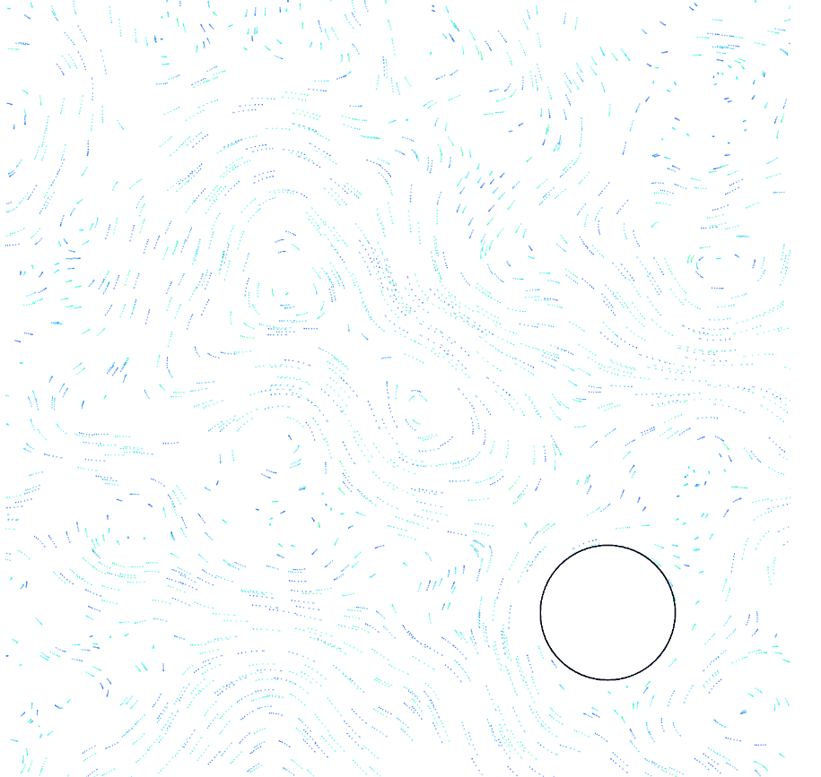

# Procedural Fluid Flow

[**Visit the Live Showcase**](https://hichwaffles.github.io/proc-fluid-sim-p5/)

This project implements a procedural fluid flow simulation based on curl noise.

**Note:** The code in this repository was written by the human author, but this `README.md` file was generated by AI.

## Acknowledgments

This project gives credit to the concepts presented in the following paper:
- **Curl-Noise for Procedural Fluid Flow** by Robert Bridson, Jim Hourihan, and Marcus Nordenstam.

## Demos

Here are some showcases of the fluid simulation:

